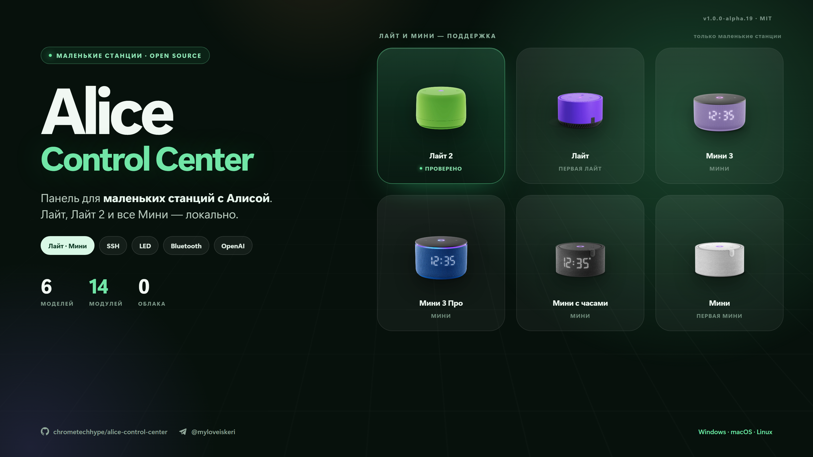

# Alice Control Center 1.0.0 Alpha 18

Выпуск про наушники. Раньше панель умела отдавать в Bluetooth-наушники только голос Алисы и свои
звуки: как только туда уходела музыка, станция считала наш же поток внешним плеером и глушила трек.
Теперь этот перехват снимается отдельным режимом, и Яндекс Музыка играет в наушниках.



## Добавлено

- **Режим «Музыку в наушники»** на экране Bluetooth. Когда звук уже в наушниках, кнопка включает
  режим: панель снимает со станции признак внешнего Bluetooth-плеера, и музыка перестаёт
  обрываться. Вторая кнопка возвращает всё обратно — «Только голос».
- **Громкость в наушниках командует Алиса.** В цепочку вывода добавлен слой громкости на том же
  регистре `Master`, который пишет станция, поэтому «громче» и «тише» работают и в колонке, и в
  наушниках. Наушники при переключении выкручиваются до максимума, чтобы не было тихого звука,
  который невозможно поправить.

## Исправлено

- **CPU не показывал «—» после переподключения.** Панель каждый раз выбрасывала предыдущий срез
  `/proc/stat`, и первой точке не с чем было сравнивать счётчик.
- **Открытие панели с телефона по ссылке.** Адрес вида `…/?token=…` игнорировался, и с телефона
  приходилось вручную вводить 32 символа. Теперь ссылка входит сама, а токен убирается из адресной
  строки и из истории браузера.
- **Список адресов для телефона.** В него попадали VPN-адаптеры, и скопированный адрес «вообще не
  отвечал». Теперь остаются только настоящие сетевые интерфейсы, а первым идёт тот, что в одной
  подсети со станцией.
- **Маршрут звука больше не отваливается из-за морга Bluetooth.** Переключение режима перезапускает
  демон станции, и связь с наушниками рвётся на пару секунд; watchdog раньше реагировал на один
  такой пропуск и возвращал звук в колонку прямо во время трека. Теперь ждёт два подряд.

## Почему так

Станция без PulseAudio: весь её звук идёт через один ALSA-выход, и переключение в наушники — это
подмена конфигурации в `/tmp` плюс перезапуск медиа-демона. Перехват фокуса живёт в другом демоне,
который читает конфиг станции при старте, поэтому режим подменяет копию этого конфига из `/tmp` и
перезапускает именно его. **Во флеш-память ничего не пишется**: обычная перезагрузка возвращает
прошивку в исходное состояние, а панель при выключении режима снимает подмену сама.

Честное ограничение: A2DP-транспорт станции принимает ровно один поток. Пока музыка
играет в наушниках, ответ Алисы туда же не прозвучит — сначала трек нужно остановить. Голос и звуки
панели в наушниках работают как раньше.

## Как обновиться

Windows PowerShell:

```powershell
irm https://raw.githubusercontent.com/chrometechhype/alice-control-center/main/install.ps1 | iex
```

Linux и macOS:

```sh
bash <(curl -fsSL https://raw.githubusercontent.com/chrometechhype/alice-control-center/main/install.sh)
```

Можно и проще: «Настройки» → «Обновления» → «Установить» прямо в панели.

## Качество

249 тестов, проверка типов и сборка — зелёные. Релиз собирается GitHub Actions из этого тега,
архив проверяется по SHA-256.
