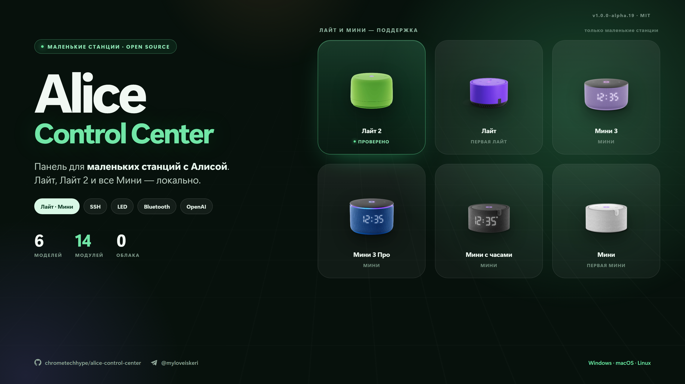

# Alice Control Center 1.0.0 Alpha 19

Выпуск про то, что панель говорит, когда до колонки не достучится. Раньше на экране мастера
подключения оставался код сокета — `connect EACCES 192.168.1.100:2222`. По нему нельзя понять, кто
виноват: колонка, Wi-Fi или сам компьютер, — и человек начинал с перегрузки колонки, которая тут
ни при чём. Теперь панель различает три случая и называет действие.



## Добавлено

- **Объяснение сетевой ошибки при подключении.** Если в той же подсети молчит и колонка, и роутер,
  панель говорит прямо: локальную сеть перекрывает VPN или файрвол на компьютере — отключите его.
  Если компьютер вообще не в подсети колонки, текст другой: панель и станция в разных сетях,
  подключите их к одному Wi-Fi.
- **Причина у пустого поиска.** «Найти колонку в сети» без результата больше не молчит в пустоту:
  когда роутер тоже не отвечает, панель объясняет, что виноват не поиск.
- **Ничего лишнего, когда сеть цела.** Если роутер отвечает, панель не ищет виноватых и остаётся при
  честном «колонка не ответила: проверьте адрес, порт и что станция включена». Диагностика сети не
  должна перекладывать ответственность на компьютер, когда та на колонке.

## Почему так

Признаком живой локальной сети служит DNS-запрос `localhost` роутеру подсети колонки. Роутер отвечает
на него, когда путь есть, и сам запрос никуда наружу не уходит — проверка ничего не отправляет в
интернет и не светит адрес колонки.

TCP на 80 и 443 для этой роли не годится, и это проверено на реальной сети: домашний роутер молчит на
оба порта при полностью живом соединении. Проверка по ним звала бы «отключи VPN» всякий раз, когда
колонку просто выключили из розетки, — а это ровно тот текст, который отправляет человека чинить не то.

## Как обновиться

Windows PowerShell:

```powershell
irm https://raw.githubusercontent.com/chrometechhype/alice-control-center/main/install.ps1 | iex
```

Linux и macOS:

```sh
bash <(curl -fsSL https://raw.githubusercontent.com/chrometechhype/alice-control-center/main/install.sh)
```

Можно и проще: «Настройки» → «Обновления» → «Установить» прямо в панели.

## Качество

260 тестов, проверка типов и сборка — зелёные. Одиннадцать новых тестов покрывают диагностику сети,
включая случай «роутер отвечает — ничего не выдумываем». Оба сценария проверены вживую: поднятый
VPN-туннель и колонка, ушедшая из этой сети, дают разные тексты. Релиз собирается GitHub Actions из
этого тега, архив проверяется по SHA-256.
