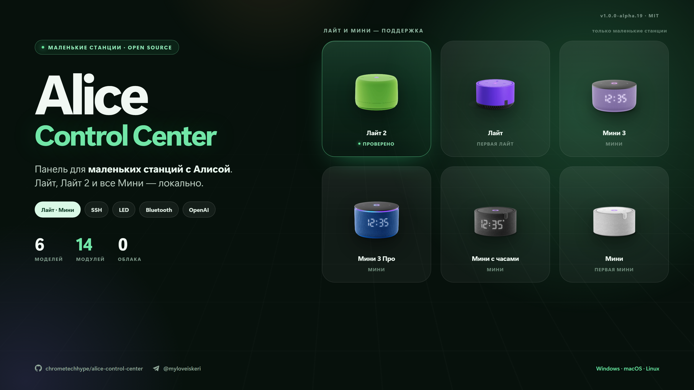

# Alice Control Center 1.0.0 Alpha 20

Выпуск про обещания и про раскладку звука. Первое: панель больше не предлагает модели, на которых
ничего не проверялось. Второе: переключение вывода в Bluetooth-наушники перестало зависеть от того,
как устроена одна конкретная прошивка, — на ранних станциях оно просто не работало.



## Исправлено

- **Звук в наушники на прошивках без `/tmp/asound-vol.conf`.** Панель писала свою цепочку только в
  файл цепочки громкости, который существует не на каждой станции. Там, где его нет, вывод не
  переключался, а на экране оставалось «Станция не отдала свой файл громкости». Теперь панель сама
  определяет, какой конфиг ALSA действительно читается: если файл цепочки есть — правит его, если
  нет — работает с копией `/etc/asound.conf` и монтирует её поверх оригинала.
- **Громкость и микрофон — имена из прошивки, а не из панели.** Прежний путь зашивал и имя
  регулятора, и путь записи; на другой модели это значило либо неподвижную громкость, либо глухую
  колонку. Теперь оба имени читаются из её же конфига.
- **Честный отказ вместо тихой поломки.** Если раскладка конфига не опознана, звук остаётся в
  колонке, а панель говорит об этом прямо и прикладывает список найденных файлов. По одному такому
  скриншоту модель добавляется — раньше для этого нужно было угадывать.

## Изменено

- **Неподдерживаемые модели убраны везде, где они предлагались:** из списка «Модель станции» в
  настройках, с обложки и из перечисления в README. Выбрать можно Лайт, Лайт 2 и семейство Мини.
  Большая станция по-прежнему подключается и работает с диагностикой, файлами, терминалом, бэкапами
  и обновлениями — панель просто больше не зовёт выбрать то, на чём ничего не проверялось.

## Почему так

Станция без PulseAudio: весь её звук идёт через один ALSA-выход, и переключение — это подмена
конфигурации в памяти плюс перезапуск медиа-демона. Разные прошивки держат этот конфиг по-разному,
поэтому панель теперь спрашивает у станции, где он лежит, а не предполагает. **Во флеш-память ничего
не пишется**: подменённый файл живёт в `/tmp`, обычная перезагрузка возвращает прошивку в исходное
состояние, а выключение режима снимает подмену сама.

## Как обновиться

Windows PowerShell:

```powershell
irm https://raw.githubusercontent.com/chrometechhype/alice-control-center/main/install.ps1 | iex
```

Linux и macOS:

```sh
bash <(curl -fsSL https://raw.githubusercontent.com/chrometechhype/alice-control-center/main/install.sh)
```

Можно и проще: «Настройки» → «Обновления» → «Установить» прямо в панели.

## Качество

265 тестов, проверка типов и сборка — зелёные. Рендер цепочки на реальном конфиге станции сверен
байт в байт с выводом предыдущей версии, чтобы рабочий путь не изменился; новые тесты прогоняют
скрипт на трёх фикстурах конфигов — цепочка из `/tmp`, корневой конфиг с включением и одиночный
файл целиком. Релиз собирается GitHub Actions из этого тега, архив проверяется по SHA-256.
